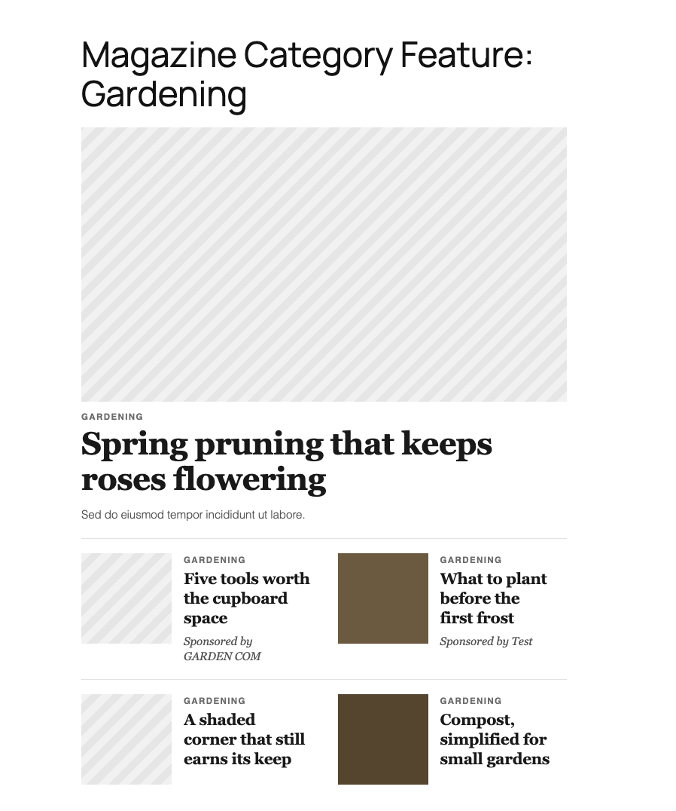
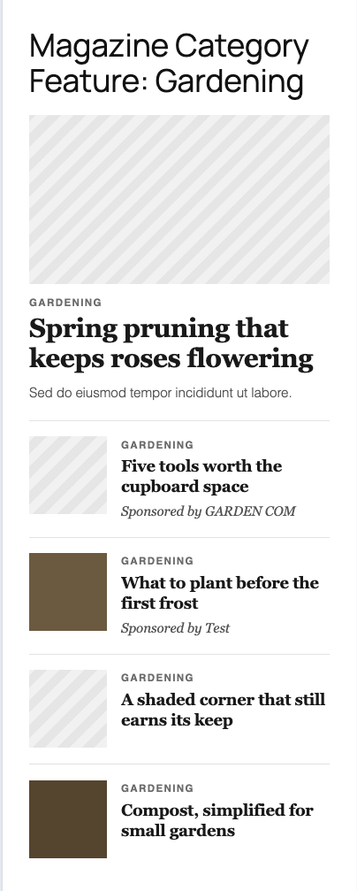

# Magazine Category Feature

A standalone Gutenberg block for magazine landing pages. An editor picks a category. The block shows that category’s newest post as a feature, then the next four as cards. Publishing a new article updates the block. Nobody has to edit the page.





## Requirements

- WordPress 6.7 or newer. Built and tested on 6.7 and 7.1.
- PHP 8.0 or newer. Built and tested on 8.3.
- Node.js 22.19.0, only if you need to rebuild the editor script. The compiled files in `build/` are in the repository, so the plugin runs without Node.
- A persistent object cache in production (WP Engine provides one). The block still works without it. The cache just does not survive the request.
- Yoast SEO can be active. The block does not print its own schema, canonical, or meta description.

## Install

1. Download the plugin from [https://github.com/vkwins/magazine-category-feature](https://github.com/vkwins/magazine-category-feature). Use **Code → Download ZIP**, or clone the repository.
2. Copy the downloaded folder into `wp-content/plugins/` so the plugin lives at `wp-content/plugins/magazine-category-feature`. GitHub’s ZIP adds the branch name, so rename `magazine-category-feature-main` to `magazine-category-feature`.
3. In WordPress admin, open Plugins and activate **Magazine Category Feature**.
4. Edit a page, add the **Magazine Category Feature** block, and choose a category in the sidebar.

To rebuild after changing `src/`:

```bash
npm install
npm run build
```

`npm start` watches and rebuilds while you work.

## Use the block

1. Insert **Magazine Category Feature**. It is in the Widgets category.
2. In the block sidebar, choose a category. Empty categories are listed too.
3. **Display category label** shows the category name above each headline. It is on by default.
4. **Show subtext (excerpt)** applies to the featured article only. Cards never show an excerpt.
5. Post order is publication date, newest first. Sticky posts are not pulled to the top. The newest post is the feature. The next four are the cards, left to right, then the next row. A sixth post is not shown.
6. Fewer than five posts still render. One post is a feature with no cards. Three posts are a feature plus one full row and a single card.
7. A category with no posts shows a note in the editor and nothing on the public page.
8. A post with no featured image shows a striped placeholder in the same shape as the image, so the headline does not jump.
9. **Sponsored by** is on the post, not on the block. Edit the article, open the **Sponsored** panel in the post sidebar, and enter a name. The card then reads “Sponsored by …”. Clear the field to remove it.

The saved page stores only the category and the two toggles. It does not store the five posts. The list is queried when the page is rendered, which is why a new article appears without anyone opening the page.

## How the code is put together

```
magazine-category-feature.php                            Loads the pieces and registers the block.
src/magazine-category-feature/includes/query.php         Five newest posts. Caches their IDs.
src/magazine-category-feature/includes/invalidation.php  Forgets those IDs when a post is saved, and asks the page cache to purge affected URLs.
src/magazine-category-feature/includes/template.php      Image, placeholder, alt text, LCP flags.
src/magazine-category-feature/includes/sponsored.php     Post meta for the sponsor name.
src/magazine-category-feature/block.json                 Attributes, and the fact that PHP renders the block.
src/magazine-category-feature/edit.js                    Sidebar controls and the live preview.
src/magazine-category-feature/sponsored.js               The post sidebar field.
src/magazine-category-feature/render.php                 The only HTML template. Editor and front end share it.
src/magazine-category-feature/style.scss                 Layout. Loaded on the front end and in the editor.
src/magazine-category-feature/editor.scss                Keeps the editor preview at full opacity.
src/magazine-category-feature/index.js                   Registers the block. There is no save() and no view.js.
build/                                                   Compiled output. WordPress reads this, not src/.
bin/seed-test-content.php                                Local posts and pages for the brief. Not used in production.
docs/brand-override.example.css
```

The block is dynamic. `save` returns `null`. `render.php` runs on each view.

Flow when an editor changes the sidebar:

1. `edit.js` reads `categoryId`, `showCategoryLabel` (Display category label), and `showExcerpt` (Show subtext (excerpt)) from the block. A change calls `setAttributes`, and the editor writes the new value onto the block.
2. `ServerSideRender` sends those attributes to WordPress.
3. `render.php` runs the same function the public page will run.
4. The preview updates. There is no second copy of the markup in JavaScript.

Flow when a reader opens the page:

1. WordPress sees the block comment in the page content.
2. `magazine_category_feature_get_posts()` returns up to five posts.
3. `render.php` prints a feature and up to four cards.
4. No front-end JavaScript is loaded for the block.

Brand styling is CSS custom properties, read at the point of use. A brand sets them on `body` in its own theme. See `docs/brand-override.example.css`. The plugin is not copied per brand.

## Assumptions

- Articles are the `post` post type, and the category is the core `category` taxonomy.
- The page that hosts the block already has an `h1` (the page title). This block starts at `h2`.
- “Newest” means `post_date`, then ID as a tiebreaker.
- The sponsor is a property of the article, so the same label appears everywhere that article is listed.
- The hero image is the likely LCP element. Only the first hero image on the page gets `fetchpriority="high"`.
- Core image sizes are used (`large` for the hero, `medium` for cards) with `object-fit: cover`. The plugin does not register new image sizes, because those would be generated for every upload on the site.
- Page caching is the cache that matters at two million views a day. The object cache only helps when PHP actually runs. See `TECHNICAL-NOTE.md`.

## Development

```bash
npm run build      # one production build
npm start          # watch
npm run lint:js
npm run lint:css
npm run plugin-zip
```

Local test content, with this plugin active:

```bash
# If you are already inside the WordPress container:
php wp-content/plugins/magazine-category-feature/bin/seed-test-content.php

# From the host, with Docker Compose:
docker compose exec wordpress php wp-content/plugins/magazine-category-feature/bin/seed-test-content.php
```

That creates Gardening (six posts, one card without an image, one sponsored card, one image with no alt text), Decorating (two posts), News (one post, no image), and Homes (no posts). It also publishes pages that use the block, plus a plain page that does not.


## Known limits

- The category dropdown asks for 100 categories. A site with more needs a searchable control.
- The page-cache purge uses a lookup table written on content save.
- Without a persistent object cache, the one hour ID cache lasts for one request only. Publishing still renders fresh posts on an uncached page, because the query itself is not stale.
- Card headlines are visually clamped at four lines. The full headline is still in the HTML.
- The ad slot is a hook, `magazine_category_feature_ad_slot`. Nothing is hooked by default, so the public page has no empty gap.
- Re-running the seed script does not delete the sixth gardening post or the empty Homes category. It updates them in place.


## Possible later work

- Real-user Core Web Vitals in the field, split by template, which a lab Lighthouse run cannot give you.
- Preload cache

## AI use

Initial plugin scaffolding was created manually with:
`npx @wordpress/create-block@latest magazine-category-feature --target-dir . --namespace magazine-category-feature --title "Magazine Category Feature"`
(commit `dfa1ed2`).

After scaffolding, development was done with Cursor AI assistance (including Grok 4.7 for drafting/support), based on the written brief and design reference.

Changes after scaffolding:

- Initial cleanup removed extra generated lines/files that were not needed for this plugin shape (for example, unnecessary scaffold output such as unused save/view paths), so the codebase started from a smaller baseline.
- AI-assisted work built the dynamic block architecture: `save: () => null`, shared PHP rendering for editor and front end, include-file split, query tuning, sponsored meta flow, styling/performance refinements, and docs/asset updates.
- AI-assisted work simplified card rendering by removing PHP row chunking in `render.php`, switching to a single-loop card output, and moving row-divider behavior into CSS pseudo-elements while keeping the same desktop/mobile layout.
- AI-assisted work replaced publish-time `post_content` scanning with lookup-table targeting for purge invalidation of pages and posts that contain the block, and removed the legacy scan fallback path for first-time production rollout.
- AI-assisted work also included targeted cleanup/refinement changes: removed unnecessary query customization hooks/flags, adjusted cache TTL constant usage, and rebuilt generated block assets after source changes.
